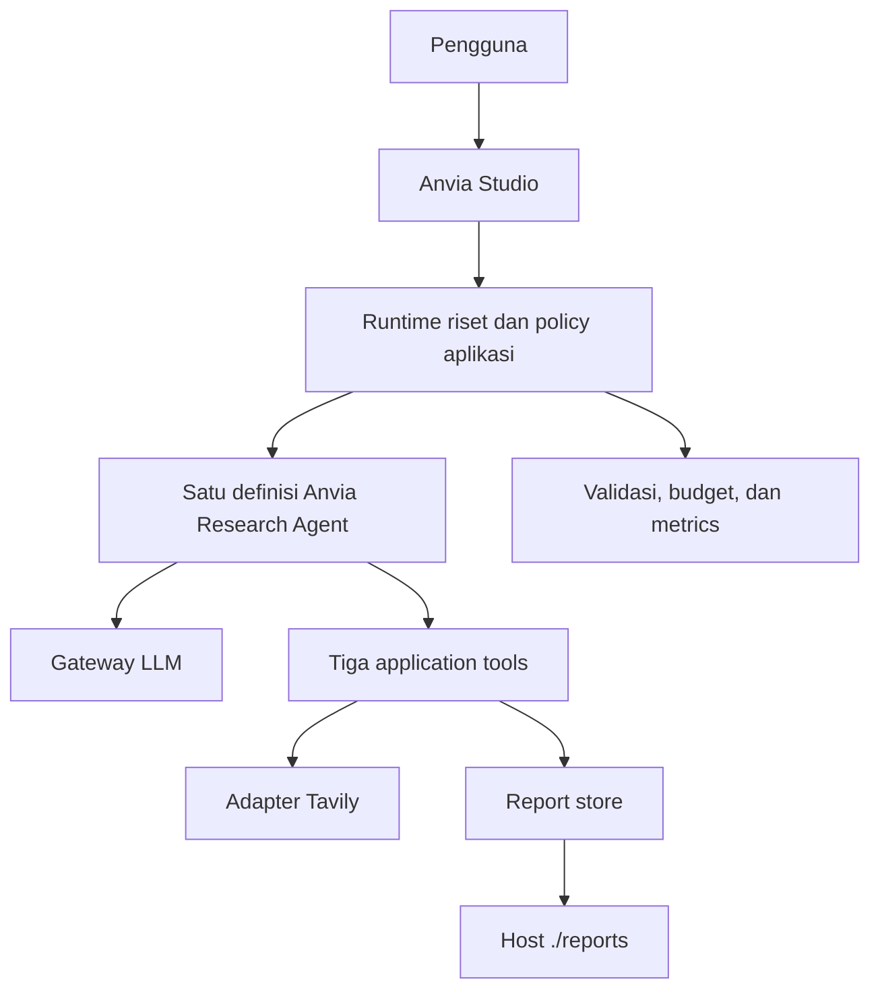

# Architecture — Simple Contextual Research Agent

**Status:** Fase 1–4 merged melalui PR #2/#3; Fase 5 verified offline/Podman, publikasi draft PR pending

**Diperbarui:** 2026-10-28

**Requirement:** [PRD.md](PRD.md)

**Eksekusi:** [PLAN.md](PLAN.md) dan [AGENTS.md](../AGENTS.md)

Dokumen ini memiliki keputusan teknis, kontrak internal, dan batas komponen. Angka budget produk dimiliki PRD; konfigurasi di sini merepresentasikan nilai tersebut tanpa mengubahnya.

## 1. Keputusan teknis

| Area             | Keputusan                                                 | Asal                                                            |
| ---------------- | --------------------------------------------------------- | --------------------------------------------------------------- |
| Bahasa/framework | TypeScript strict, Anvia SDK v1                           | PRD                                                             |
| LLM              | Gateway kompatibel OpenAI: https://gateway.devscale.id/v1 | Keputusan pengguna                                              |
| Model ID         | `gpt-6-luna`, dapat dikonfigurasi                         | Keputusan pengguna                                              |
| Search           | Tavily Search API melalui adapter                         | Keputusan pengguna; akses tersedia                              |
| Development UI   | Anvia Studio                                              | PRD                                                             |
| Host utama       | Windows, Docker Desktop dengan WSL2                       | Keputusan pengguna                                              |
| Runtime          | Satu container aplikasi/Studio, Docker Compose            | PRD                                                             |
| Penyimpanan      | File laporan di bind mount; state run dalam memori        | PRD                                                             |
| Coding agent     | Hermes; ketentuan kerja di AGENTS.md                      | Keputusan pengguna                                              |
| Tooling awal     | Node.js 24 LTS, pnpm, Vitest, ESLint, Prettier, Zod       | pnpm atas instruksi pengguna; tooling lain default implementasi |

Gunakan satu lockfile `pnpm-lock.yaml` dan `pnpm install --frozen-lockfile`. Toolchain yang diuji: Node.js 24.14.0, pnpm 11.22.0 (dipin di packageManager), TypeScript 6.0.3, Anvia core 1.17.1, provider OpenAI 1.3.5, dan Studio 1.3.20. Versi dependency dan engines dicatat di package.json. Dockerfile memakai `node:24.14.0-bookworm-slim`, build multi-stage, frozen lockfile, dan runtime production dependencies saja.

pnpm-workspace.yaml hanya mengizinkan build script esbuild. Exemption minimum release age dibatasi pada versi tooling TypeScript ESLint terpin yang diimpor dari lockfile awal; bukan menonaktifkan supply-chain policy secara global. OpenAI SDK dipin dan dioverride ke 7.43.0 agar injected client dan adapter Anvia memakai class/type yang sama.

Default implementasi dipilih untuk mengurangi setup tambahan. Perubahan kecil yang didukung hasil compatibility check dicatat; perubahan scope/perilaku produk dibahas dengan pemilik proyek.

## 2. Bentuk sistem



Runtime riset adalah komponen aplikasi, bukan agent kedua. Tidak ada queue, database, HTTP service produk tambahan, atau workflow multi-agent.

## 3. Tanggung jawab komponen

| Modul yang direncanakan              | Tanggung jawab                                               |
| ------------------------------------ | ------------------------------------------------------------ |
| `src/config/`                        | Parse environment dan default; validasi konfigurasi          |
| `src/providers/llm.ts`               | Membuat model Anvia dari endpoint/model terkonfigurasi       |
| `src/providers/search-provider.ts`   | Interface search dan implementasi Tavily                     |
| `src/agent/research.agent.ts`        | Satu factory/definisi agent dan registrasi tiga tools        |
| `src/agent/research.instructions.ts` | Behavior research agent yang diturunkan dari PRD             |
| `src/application/research-runner.ts` | Boundary run, parsing hasil, finalization, error mapping     |
| `src/application/run-state.ts`       | State terisolasi per request dan lifecycle cleanup           |
| `src/tools/`                         | Schema dan handler webSearch/writeFile/readFile              |
| `src/services/source-registry.ts`    | ID sumber, normalisasi URL, deduplikasi                      |
| `src/services/report-validator.ts`   | Validasi Markdown dan provenance                             |
| `src/services/report-store.ts`       | I/O pada lokasi laporan yang dibatasi                        |
| `src/services/resource-limiter.ts`   | Counter, deadline, cancellation, terminal latch              |
| `src/services/run-metrics.ts`        | Metrics dan logging yang aman                                |
| `src/schemas/`                       | Research response, keputusan model, dan kontrak hasil        |
| `src/studio.ts`                      | Mendaftarkan runtime/agent yang sama ke Studio               |
| `src/index.ts`                       | Entry point tipis untuk pemanggilan programatik/headless     |
| `src/evals/`                         | Suite Anvia evals dan fixture                                |
| `tests/`                             | Unit, integration, offline behavior, dan live tests terpisah |

Gunakan pemisahan modul biasa dan dependency injection lewat parameter/factory. M1 tidak membutuhkan container DI, repository database, atau lapisan Clean Architecture tambahan.

## 4. Boundary run dan state

Aplikasi membuat UUID sebagai `runId`. ID internal Anvia, jika berbeda, dicatat sebagai `sdkRunId` untuk korelasi. Keduanya berasal dari kode, bukan input LLM.

State minimum per run:

- Identitas, waktu mulai, deadline, dan cancellation controller.
- Source registry, jumlah search yang dimulai, jumlah search yang berhasil.
- Model/tool counters dan token usage yang tersedia.
- Jumlah draft yang ditolak; kuota revisi tersisa.
- Konten/hash draft tervalidasi, report path internal, successful write/read flags.
- Konten/hash hasil read-back, status terminal, dan kategori error.

State dilepas setelah finalisasi; outcome/metrics disalin sebelum cleanup. Tidak ada `currentRun` mutable global yang dipakai bersama beberapa request.

Factory dapat mengikat tools pada state request untuk pemanggilan headless. Integrasi Studio harus mengikat scope baru untuk setiap `generate`/`stream` menggunakan extension/lifecycle/boundary yang benar-benar didukung versi SDK terpasang. Binding ini dibuktikan dalam P1-02, termasuk saat dua run overlap. Jangan menambahkan properti SDK rekaan untuk membawa state.

Satu definisi agent boleh membuat instance yang scoped jika diperlukan; ini tetap satu jenis research agent, bukan multi-agent orchestration.

### Boundary yang wajib sama di Studio dan runner

Studio mengeksekusi objek runtime yang didaftarkan. Karena itu, validasi, counter, deadline, dan finalization tidak boleh hanya ada pada CLI wrapper yang dilewati Studio.

P1-02 harus membuktikan binding context dan policy yang sama untuk generation dan streaming. Jika SDK terpasang memerlukan adapter tipis, tempatkan adapter pada boundary runtime dan uji dengan fake model. Final application response diterbitkan setelah policy checks; draft text/stream event tidak dianggap sebagai completed.

Direct tool invocation tanpa scope run yang sah ditolak sebelum side effect. Unit test membuat scope sintetis secara eksplisit. Panel Tools Studio tidak boleh menjadi jalur untuk melewati budget atau akses filesystem.

### Hasil spike P1-02

src/application/scoped-agent.ts menyediakan adapter tipis turunan Agent: setiap generate/stream membuat instance SDK baru, UUID aplikasi, timer/AbortSignal, dan tools yang menutup scope request. Lifecycle menyimpan sdkRunId dan menjalankan callback finalization sebelum terminal outcome. Model attempts dihitung sebelum completion; cleanup juga berjalan ketika pembuatan scoped tools, provider, finalizer, atau cancellation gagal. Uji dua generation/stream overlap membuktikan identitas dan cleanup terpisah; ini bukan bukti bahwa seluruh research policy Fase 3/4 sudah tersedia.

Studio 1.3.20 secara default mengkloning agent untuk trace observer; clone menghilangkan override generate/stream pada adapter. Karena itu src/application/scoped-studio.ts memakai stores.sessions=false, pipelineLogs=false, pipelineRuns=false tanpa model registry. Ini menonaktifkan trace store default dan mempertahankan objek scoped asli. Route buffered dan streaming diuji lewat Studio.app.request dengan fake model, bukan sekadar memeriksa daftar agent. Jangan mengganti factory ini dengan new Studio default atau mengaktifkan model registry/trace storage tanpa mengulang compatibility checks. Pembatasan input riset stateless kini ditegakkan Fase 3. UI/server/Docker dan trace persistence tetap task Fase 5.

### Binding produk Fase 3

`src/agent/research.agent.ts` menggunakan factory scoped tersebut dengan hook typed `prepareInput` dan `transformResponse`. Input menerima string atau user message berbasis teks; untuk history Studio hanya pesan terakhir yang harus user dipakai. Envelope divalidasi Zod dan panjang request dibatasi sebelum model. Session/continuation dan override policy runtime tidak diteruskan. Hook default kosong menjaga kompatibilitas probe Fase 1.

State handler/usage/outcome disimpan dalam WeakMap dengan key scope request dan dihapus pada close. Middleware mengubah kandidat final non-tool menjadi JSON response aplikasi sebelum SDK membuat terminal text/output; lifecycle finalizer memeriksa hasilnya lagi. Event delta/turn tetap draft, tidak boleh dianggap completed. `.run(prompt)` memparse output boundary yang sama menjadi typed ResearchResponse, tanpa model kedua atau pembacaan file tambahan.

Policy memeriksa search/write/read-back flags, terminal latch, strict AgentDecision schema, dan citation sources yang dipakai. Source count tidak mencakup hasil search yang tidak dikutip. Metrics dicatat lewat safe logger, token raw Chat yang hilang tetap null. Invalid input tetap menolak sebelum scope dibuat. Fase 4 memetakan kegagalan run menjadi response aplikasi yang sama pada generation, terminal stream event, `stream.result`, `stream.text`, dan route Studio; exception mentah tidak dijadikan final response.

Hook `beforeCompletion` memeriksa terminal latch dan counter model sebelum request berikutnya: jumlah model attempts dibatasi eksplisit oleh aplikasi, tidak hanya mengandalkan arti `maxTurns` SDK. Satu revisi memakai scope, counter, dan deadline awal. Penolakan kedua atau filesystem failure menghentikan model call berikutnya. Deadline/kuota menghasilkan `budget_exceeded`; pembatalan pengguna menghasilkan `failed` dengan metrics kategori `cancelled`. Provider failure bukan `insufficient_evidence`, dan draft yang sudah ditolak tidak boleh diganti labelnya menjadi no-evidence.

Recovery berada pada adapter yang menangkap exception asli SDK sebelum scope ditutup. Lifecycle `onError` SDK 1.17.1 memakai snapshot error yang menghilangkan prototype; karena itu adapter tidak mengklasifikasikan `MaxTurnsError` dari snapshot tersebut. Pada research agent, `textStream` mengeluarkan JSON terminal yang sudah melewati policy tepat sekali, sama dengan `.text` dan `.result.text`, bukan delta mentah yang belum tervalidasi. Generic compatibility probe tanpa hook recovery tetap mempertahankan semantik SDK. P4-01–P4-04 memiliki regression tests offline; integrasi UI/trace/bind mount tetap Fase 5.

## 5. Model provider dan konfigurasi

Gunakan `@anvia/openai` dengan custom `baseUrl`. Default awal yang akan diuji adalah Chat Completions (`LLM_API=chat`). Jangan menganggap URL berakhiran /v1 juga mendukung Responses API.

Gateway/model ini merupakan pilihan deployment, bukan kompatibilitas yang sudah terbukti. LIVE-01 menguji tool calling, pengembalian tool result, final output, cancellation/usage yang tersedia, dan API mode yang dipilih. Jangan diam-diam mengganti model, endpoint, atau API mode jika gagal.

Finalisasi tidak memerlukan model kedua atau LLM call tambahan di luar agent loop. Model mengusulkan keputusan akhir yang diparse dan divalidasi lokal:

```typescript
type AgentDecision = {
  status: "completed" | "needs_clarification" | "insufficient_evidence";
  message: string;
};

type ResearchStatus =
  | "completed"
  | "needs_clarification"
  | "insufficient_evidence"
  | "budget_exceeded"
  | "failed";

type ResearchResponse = {
  runId: string;
  status: ResearchStatus;
  message: string;
  reportPath?: string;
  sources?: string[];
};
```

Keputusan model adalah kandidat. Path, sumber, dan status akhir dibangun aplikasi dari state. Jika provider-native structured output tersedia dan lolos uji, boleh digunakan; validasi lokal tetap wajib. Jika tidak tersedia, gunakan JSON yang diparse lokal dan tolak output malformed secara aman, tanpa classification call tambahan.

Konfigurasi yang harus disediakan Fase 1:

```dotenv
NODE_ENV=development
OPENAI_BASE_URL=https://gateway.devscale.id/v1
OPENAI_API_KEY=
LLM_MODEL=gpt-6-luna
LLM_API=chat
TAVILY_API_KEY=
REPORTS_DIR=/app/reports
MAX_WEB_SEARCH_CALLS=3
MAX_AGENT_TURNS=5
MAX_EXECUTION_MS=60000
MAX_REPORT_REVISIONS=1
TOOL_CONCURRENCY=1
STUDIO_PORT=4021
ALLOW_LIVE_TESTS=false
```

Contoh REPORTS_DIR di atas berlaku dalam container. Untuk smoke test headless dari WSL2 sebelum Fase 5, gunakan ./reports atau direktori sementara yang writable; Compose nanti menetapkan /app/reports di dalam container.

Budget defaults mengikuti PRD. Kredensial hanya ada di environment lokal; contoh file selalu kosong. Adapter config menerjemahkan nama env ke API SDK yang diverifikasi, termasuk menonaktifkan retries pada lapisan yang relevan.

src/providers/llm.ts menginjeksi OpenAI client dengan baseURL terkonfigurasi, maxRetries=0, dan timeout; model Anvia tetap memakai api=chat. Agent retries=false adalah lapisan terpisah. Tests memakai fetch sintetis untuk memeriksa path /chat/completions, model, cancellation, dan satu request saja saat HTTP 429/500/503. SDK mengisi usage yang hilang dengan nol; getReportedTokenUsage membaca raw Chat usage agar metrics mencatat null bila tidak dilaporkan gateway. Tidak ada endpoint/model fallback.

Guard teknis awal, sebagai default implementasi: prompt maksimum 8.000 karakter, query 500 karakter, snippet 1.500 karakter per hasil, dan laporan 65.536 byte UTF-8. Semua ukuran diperiksa sebelum operasi mahal atau I/O dan bisa dikonfigurasi. Ini bukan batas token atau jaminan biaya moneter.

## 6. Kontrak tools

### webSearch

```typescript
type WebSearchInput = { query: string };
type Source = {
  sourceId: string;
  title: string;
  url: string;
  snippet: string;
  publishedAt?: string;
};
type WebSearchResult = { results: Source[] };

interface SearchProvider {
  search(
    query: string,
    options: { maxResults: number; signal: AbortSignal },
  ): Promise<Array<Omit<Source, "sourceId">>>;
}
```

Urutan: validasi query dan active scope, periksa deadline/kuota, reservasi counter, panggil Tavily dengan signal, periksa status run kembali, normalisasi dan batasi hasil, lalu tambahkan ke registry.

Minta hasil pencarian ringkas; tidak meminta full raw page atau jawaban generatif Tavily. Batasi maksimum lima hasil. Provider failure dibedakan dari array kosong. Jangan meneruskan response/provider error mentah yang memuat header atau kredensial.

Registry menerima HTTP(S), menghapus fragment dan menormalkan URL secara konservatif; jangan menghapus parameter yang mungkin mengubah sumber. URL normalisasi yang dikembalikan ke model menjadi nilai whitelist. Sumber berulang memakai ID yang sama dalam run; run baru memulai registry baru.

Tanggal sumber bersifat opsional. Jangan mengisi tanggal publikasi dengan waktu pencarian seolah-olah keduanya sama.

### writeFile

```typescript
type WriteFileInput = { content: string };
type WriteFileResult =
  | { success: true; path: string; bytesWritten: number }
  | {
      success: false;
      code: "INVALID_REPORT";
      issues: string[];
      canRevise: boolean;
    };
```

Handler memeriksa scope, terminal latch, deadline, dan successful write quota. Validator berjalan sebelum report store menulis.

Penolakan konten pertama mengembalikan issues yang aman; pengiriman berikutnya adalah satu-satunya revisi. Penolakan kedua menetapkan failure latch dan menghentikan pekerjaan berikutnya. Penerimaan pertama menutup izin write berikutnya. I/O failure dipetakan sebagai failed, bukan revisi konten tambahan.

`path` selalu dibuat aplikasi dari reports root dan UUID run. Input model tidak menerima path, nama file, atau shell command.

### readFile

Input schema adalah objek kosong. Hanya file milik run aktif yang sudah berhasil ditulis yang dapat dibaca.

```typescript
type ReadFileResult = {
  success: true;
  content: string;
  path: string;
};
```

Handler melakukan satu successful filesystem read, membandingkan byte/hash dengan draft tervalidasi, dan memvalidasi kembali isi yang sudah ada dalam memori. Finalizer menggunakan hasil verifikasi ini; tidak melakukan read kedua tersembunyi.

Error read, file hilang, atau konten berubah menghasilkan failed dan tidak memublikasikan reportPath sebagai laporan berhasil.

## 7. Validasi dan report store

Validator memeriksa:

- Konten tidak kosong, ukuran byte, judul, temuan utama, dan bagian sumber.
- Citation ID dalam badan laporan memiliki pasangan registry dan daftar sumber.
- URL dan ID pada bagian sumber cocok; tidak ada ID/URL asing.
- Minimal satu citation relevan dan sumber yang digunakan dapat diidentifikasi.
- Link Markdown, reference link, autolink, dan URL literal di seluruh laporan diperiksa; bukan hanya regex pada bagian Sources.
- Pemeriksaan mekanis tidak mengklaim membuktikan seluruh dukungan semantik.

Parser/implementasi ekstraksi link dipilih pada Fase 2 dan diuji dengan fixture negatif. Panjang 150–500 kata menjadi feedback kualitas, bukan hard failure tunggal.

Lokasi publikasi adalah `/app/reports/<runId>/report.md`. Root dikonfigurasi, di-resolve, dan diperiksa pada startup. Gunakan direktori run baru, validasi containment dengan path semantics, periksa symlink pada komponen relevan, dan hindari mengikuti symlink file. String-prefix check saja tidak cukup.

Tulisan sementara dan publikasi atomik internal diperbolehkan; batas satu successful write mengacu pada satu publikasi report lewat application tool. Jangan menimpa laporan run lain. Bersihkan temporary file milik run yang gagal bila aman. Laporan yang sudah tertulis tetapi gagal verifikasi tidak boleh ditawarkan sebagai completed.

Reports root pada host adalah area development tepercaya. Container bukan isolasi filesystem per request dan tidak melindungi dari pemilik host yang sengaja memodifikasi direktori secara bersamaan.

## 8. Budget, error, dan finalization

Setiap handler memeriksa budget sebelum dan setelah operasi asynchronous. Counter direservasi sebelum provider call; kegagalan provider tetap memakai kuota. Penolakan argumen sebelum I/O tetap tercatat sebagai tool attempt dan dibatasi turns/deadline. Pada boundary SDK, middleware `onToolInput` menghitung attempt sebelum schema validation; lifecycle `onToolStart` berjalan terlalu lambat untuk input invalid. `RunScope.toolCallsTrackedByRuntime` bernilai true untuk run SDK dan false pada scope sintetis direct-handler, sehingga counter tidak dihitung dua kali. Tool fixture yang terikat boundary juga memakai counter runtime.

Deadline menggunakan cancellation yang diteruskan ke model/search yang mendukungnya. Jangan hanya memakai Promise.race yang meninggalkan side effect berjalan. Hasil terlambat diabaikan; run yang sudah terminal tidak dapat kembali menjadi completed. Provider yang tidak kooperatif mungkin masih menyelesaikan request remote, sehingga timeout lokal bukan bukti billing remote berhenti.

Error tool dapat dikembalikan runtime ke model. Karena itu, hard limit dan failure latch ditegakkan handler/boundary; melempar error saja tidak dianggap menghentikan agent.

| Kondisi                                                                                                      | Keputusan aplikasi    |
| ------------------------------------------------------------------------------------------------------------ | --------------------- |
| Deadline atau kebutuhan operasi melebihi limit                                                               | budget_exceeded       |
| Penolakan draft revisi, I/O failure, output malformed, atau dependency failure yang tidak dapat diselesaikan | failed                |
| Kandidat completed dan semua flag/hash/verifikasi sah                                                        | completed             |
| Kandidat needs_clarification, tanpa search/write, pertanyaan valid                                           | needs_clarification   |
| Kandidat insufficient_evidence setelah search berhasil, tanpa publikasi laporan                              | insufficient_evidence |
| Klaim final tidak konsisten dengan state                                                                     | failed                |

Terminal latch pertama yang sah tidak ditimpa respons model berikutnya. Stop reason dan waktu kejadian disimpan agar error budget tidak tertukar dengan error layanan. Jika beberapa operasi bersaing, hasil setelah terminal latch tidak diterima.

Semua model retries dan automatic tool/provider retries dinonaktifkan pada M1. Koreksi query yang dilakukan agent adalah search call baru dalam kuota, bukan transport retry gratis.

## 9. Docker Desktop/WSL2 dan Studio

Jalankan perintah proyek dari shell WSL2 di direktori repository. Gunakan Docker Compose v2-compatible dan Linux containers. Fase 5 menyediakan Dockerfile, `compose.yaml`, `.dockerignore` berbasis allowlist, dan [instruksi permission bind mount](CONTAINERS.md). Podman adalah alternatif verifikasi yang dipilih pengguna; hasilnya tidak dilaporkan sebagai Docker Desktop acceptance.

- Aplikasi berjalan sebagai non-root, tanpa privileged mode dan tanpa Docker socket.
- `./reports` di-mount ke `/app/reports` dan tidak dimasukkan Git.
- Awal limit container: 1 CPU dan memory 1 GiB; ini limit container, bukan kuota per run.
- Coba read-only root filesystem dengan tmpfs untuk lokasi sementara; laporan tetap writable. Catat bila SDK memerlukan penyesuaian yang sempit.
- Studio standalone default bind `127.0.0.1`; image/Compose secara eksplisit menetapkan `STUDIO_HOST=0.0.0.0` di dalam container. Publish host hanya `127.0.0.1:4021:4021`. Host/Origin guard bukan autentikasi.
- Browser membuka http://localhost:4021. Jangan memublikasikan Studio ke jaringan umum.
- Konfigurasi requests mengakses gateway terpilih dan Tavily; tidak ada tool arbitrary fetch atau shell. Compose standar sendiri tidak menerapkan domain egress allowlist.
- Atur ownership/UID reports dengan jelas; hindari menjadikan chmod 777 sebagai solusi default.

Tidak memasang memory adapter untuk research agent. Untuk demonstrasi request independen, gunakan session/playground baru dan pastikan boundary hanya menerima permintaan aktif; history UI Studio bukan product conversation memory. Hal ini diuji di P5-02.

`src/studio.ts` memparse environment dan menjalankan `createResearchStudio` / `serveResearchStudio`; factory memakai `createResearchRuntime` yang sama dengan headless. UI diaktifkan melalui opsi pada factory scoped; session/trace/pipeline stores tetap nonaktif agar SDK tidak mengkloning agent. Entrypoint tidak memuat `.env` sendiri; command lokal memakai `node --env-file=.env`, container menerima environment dari Compose. Startup failure hanya mengeluarkan `STUDIO_STARTUP_FAILED`; SIGTERM/SIGINT memicu graceful shutdown.

Debug tersedia melalui event JSONL `tool_call`, `tool_result`, dan terminal `response` pada request streaming Playground, serta metrics aman stdout. Tidak ada database/persisted trace browser; event dapat diperiksa selama run dan disimpan manual untuk contoh aman. Ini menggantikan kebutuhan trace persistence spike, bukan mengaktifkan default store yang terbukti melewati scope. Hanya terminal response yang policy-checked; delta/turn/tool events merupakan debug draft. UI dan assets, history isolation, direct tools, quota, dan provider-failure mapping diuji melalui server HTTP nyata dengan fake dependencies.

Sandbox Compose menggunakan read-only root, reports bind mount, `/tmp` tmpfs 64 MiB, UID/GID 1000, CPU 1, memory 1 GiB, PID 128, cap-drop ALL, dan no-new-privileges. Harness acceptance container terpisah menyuntikkan fake dependencies; server produksi tidak memiliki fake-mode environment. Harness memeriksa image produksi lalu HTTP fake-run, host/container byte equality, serta persistensi setelah recreate. Pengujian `run` sandbox dan validasi Compose dicatat sebagai bukti terpisah.

## 10. Observability dan test seams

Catat metrics minimum dari PRD, tambahan jumlah validation rejection dan search success untuk diagnosis. `source_count` berarti sumber yang dipakai laporan, bukan semua hasil yang ditemukan. Nilai token yang tidak tersedia menggunakan null/availability flag.

Log hanya ringkasan operasional dan kategori error. API keys, authorization headers, serta raw provider error tidak masuk log, laporan, fixture, atau PR. Trace inspeksi menggunakan data riset contoh yang aman.

Dependency yang dapat diganti dalam test: model, search provider, clock/deadline, report root/store, dan logger. Gunakan filesystem sementara untuk test store; gunakan bind mount sungguhan hanya untuk acceptance Docker.

Evaluasi Fase 6 memakai export `@anvia/core/evals` pada versi yang sudah dipin, bukan command SDK yang diasumsikan tersedia. Mandatory cases menggunakan fixture runtime nyata dengan model/search scripted; supporting quality menggunakan fixture dan rubrik eksplisit, tanpa paid judge. Gate harus menolak mandatory failure, target/metric error, dan suite mandatory yang tidak ditemukan—bukan merata-ratakan hasil supporting untuk menutupi kegagalan.

LIVE-03 terpisah dari ordinary checks. `scripts/live.ts --case LIVE-03` memerlukan opt-in, menolak budget di atas batas PLAN, dan menjalankan satu POST streaming pada scoped Studio lokal sementara. Harness membandingkan byte host dengan hasil application read-back, memeriksa metrics/tool events, lalu menyimpan ringkasan evidence dan snippet sumber publik terpakai di reports root. Store trace/session SDK tetap nonaktif; ringkasan acceptance bukan raw JSONL atau product memory. Server dihentikan setelah probe, tidak ada retry/fallback otomatis. Detail command dan rubric kualitas ada di [EVALUATION](EVALUATION.md); hasil aktual dimiliki CONTEXT.

## 11. Verifikasi yang masih diperlukan

| ID   | Verifikasi                                                                            | Task pemilik   |
| ---- | ------------------------------------------------------------------------------------- | -------------- |
| V-01 | Versi SDK, lifecycle, binding state dan policy pada generation/streaming/Studio       | P1-01, P1-02   |
| V-02 | Chat API dan tool-result round-trip pada gateway/model pilihan                        | LIVE-01        |
| V-03 | Bentuk hasil Tavily dan pemetaan source fields                                        | P2-01, LIVE-02 |
| V-04 | Non-root, permission reports, read-only root, dan UI isolation di Docker Desktop/WSL2 | P5-01, P5-02   |

Ini merupakan verifikasi implementasi, bukan keputusan pengguna yang perlu ditanyakan ulang. Kegagalan dicatat secara konkret; jangan menandai dukungan sebagai terbukti sebelum diuji.

## 12. Referensi resmi

- [Anvia compatible APIs](https://docs.anvia.dev/sdk/providers/compatible) dan [pemilihan Chat/Responses](https://docs.anvia.dev/sdk/providers/compatible/adapters).
- [Anvia errors and limits](https://docs.anvia.dev/sdk/agents/errors-and-limits).
- [Anvia tool validation/execution](https://docs.anvia.dev/sdk/tools/validation-and-execution).
- [Anvia runtime lifecycle](https://docs.anvia.dev/sdk/agents/runtime-lifecycle) dan [Studio](https://docs.anvia.dev/studio/).
- [Node.js 24 LTS](https://nodejs.org/en/blog/release/v24.22.0).

Dokumentasi resmi memberi rujukan API. Signature dan perilaku aktual tetap diverifikasi terhadap paket yang dipin pada Fase 1.
